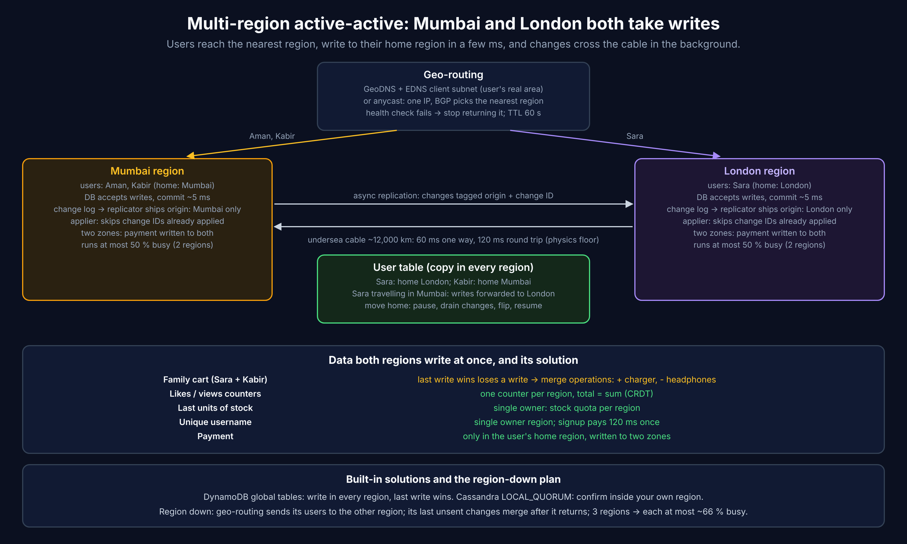

# Video 34 architecture: The shop running active-active in Mumbai and London

## What the diagram shows

Code for this video: `code/active_active.py` (Python, problem and solution versions, runs with `python3 active_active.py`).

The shop's Mumbai and London regions (from Videos 28, 32, 33) both accepting writes. Geo-routing sends each user to the nearest region, each user's writes go to their home region and commit there in a few ms, and each region ships its own changes across the undersea cable in the background. The bottom panels list the data both regions still write at once, with the solution for each, and the plan for losing a region.

## Components

**Geo-routing.** GeoDNS answers with the nearest region's IP; EDNS client subnet passes the first part of the user's IP so a far-away public resolver does not mislead it. Anycast (one IP announced from both regions, BGP picks the nearest) or latency-based routing are the other options. On a failed health check the region stops being returned; DNS TTL is kept short (about 60 s).

**Mumbai and London regions.** Each has a database that accepts writes (commit about 5 ms), a change log, a replicator that ships only changes whose origin is its own region (no ping-pong loop), and an applier that skips change IDs it has already applied. Payment writes go to two zones (buildings) synchronously. Each region runs at most 50 % busy so it can take the other's users.

**Undersea cable.** About 12,000 km; light in fibre about 200,000 km/s, so 60 ms one way and 120 ms round trip. No server upgrade beats it; sequential writes multiply it (8 writes = 960 ms).

**User table.** Copied to every region; holds each user's home region. A travelling user's writes are forwarded to the home region (only that user pays 120 ms). Moving a home region: pause writes, wait for the old region's changes to arrive, flip, resume.

## Flows

1. Sara (London) checks out: routed to London, 8 writes commit locally (about 10 ms), changes reach Mumbai about 60 ms later.
2. Sara travels to Mumbai: routed to Mumbai, which forwards her writes to London, so she always reads her own writes.
3. Sara and Kabir edit the family cart at once: both operations ship across and are merged in both regions.
4. London goes down: geo-routing sends London users to Mumbai; London's last unsent changes merge after it comes back.

## What fails and its solution

- **Every London write crosses the cable (about 1 s checkout).** Solution: active-active, commit in the user's own region.
- **Replicated changes loop back forever.** Solution: origin tag on every change; change IDs for duplicate batches.
- **Public resolver far from the user.** Solution: EDNS client subnet; or anycast.
- **Travelling user loses their own write.** Solution: home region; forward writes there.
- **Whole-cart last write wins drops a write.** Solution: merge by data type (operations set; per-region counters, CRDT).
- **Stock, usernames, payments must never conflict.** Solution: single owner (stock quota per region, one owner region for usernames, payment only in the home region).
- **Region down.** Solution: geo-routing failover, zones for payments, capacity headroom (2 regions at most 50 % busy, 3 regions about 66 %).
- Built in: DynamoDB global tables (write anywhere, last write wins); Cassandra LOCAL_QUORUM (confirm inside your own region).
