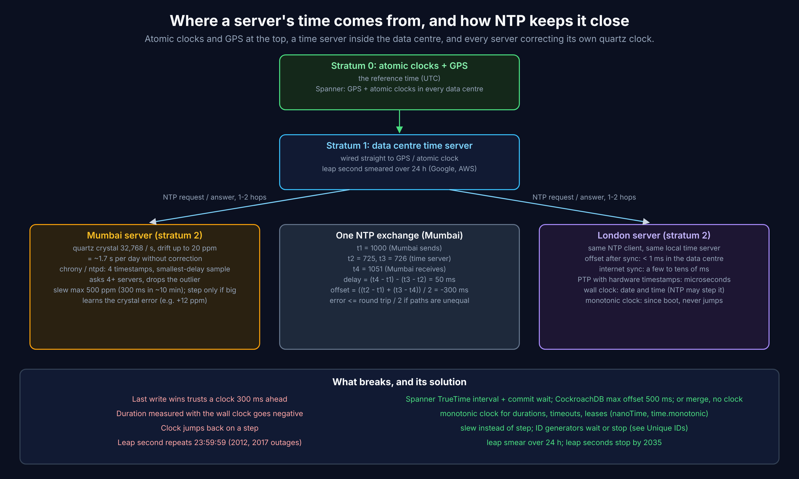

# Video 35 architecture: Where a server's time comes from

## What the diagram shows

Code for this video: `code/clocks_ntp.py` (Python, problem and solution versions, runs with `python3 clocks_ntp.py`).

The time hierarchy behind the shop's servers: atomic clocks and GPS (stratum 0), a time server inside the data centre wired to them (stratum 1), and the Mumbai and London servers (stratum 2) that keep correcting their own quartz clocks with NTP. The middle panel is the one NTP exchange from the video with its numbers; the bottom panel lists what breaks when code trusts clocks the wrong way, with the solution for each.

## Components

**Stratum 0: atomic clocks and GPS.** The reference time (UTC). Google Spanner puts GPS receivers and atomic clocks in every data centre for TrueTime.

**Stratum 1: data centre time server.** Wired straight to GPS or an atomic clock; our servers reach it in one or two hops. Google and AWS smear leap seconds over 24 hours here, so no server ever sees 23:59:60.

**Server clocks (stratum 2).** A quartz crystal vibrating 32,768 times a second drives a counter; it can be off by 20 ppm (about 1.7 s a day), more with heat or a paused VM. The NTP client (chrony or ntpd) sends many requests, trusts the sample with the smallest round trip, asks at least four servers and drops the outlier, slews the clock (at most 500 ppm, so 300 ms takes about 10 minutes) and steps only for big offsets such as at boot. It also learns the crystal's own error. Each server has two clocks: the wall clock (date and time, NTP may step it) and the monotonic clock (since boot, never jumps, meaningless on another machine).

## Flows

1. NTP exchange: t1 = 1000 (Mumbai sends), t2 = 725 and t3 = 726 (time server), t4 = 1051 (Mumbai receives). Delay = (t4 - t1) - (t3 - t2) = 50 ms. Offset = ((t2 - t1) + (t3 - t4)) / 2 = -300 ms: Mumbai's clock is 300 ms ahead.
2. If the paths are unequal (40 ms out, 10 ms back) the offset is 15 ms wrong; the error is never more than half the round trip.
3. Typical accuracy: internet a few to tens of ms; same data centre under 1 ms; PTP with hardware timestamps microseconds.

## What fails and its solution

- **Last write wins trusts a clock 300 ms ahead.** Solution: Spanner TrueTime interval + commit wait; CockroachDB maximum clock offset (500 ms, a far-off node shuts itself down); or merge without clocks.
- **Duration measured with the wall clock goes negative, timeouts fire early, leases expire early.** Solution: monotonic clock (System.nanoTime, time.monotonic, CLOCK_MONOTONIC).
- **Clock jumps back on a step.** Solution: slew instead of step; ID generators wait or stop (Video 31).
- **Leap second repeats 23:59:59 (30 June 2012 Linux CPU spikes, 1 January 2017 Cloudflare DNS outage).** Solution: leap smear over 24 hours; leap seconds stop by 2035.
