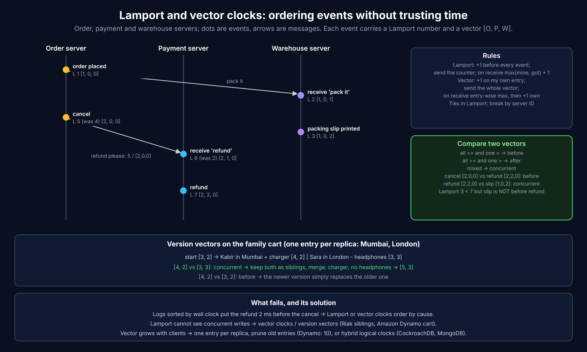

# Video 36 concept diagram: Lamport and vector clocks

## What the diagram shows

Three servers of the shop (order, payment, warehouse) as vertical lanes. Dots are events, arrows are messages. Each event carries its Lamport number (L) and its vector clock [Order, Payment, Warehouse]. The side panels hold the rules and the compare test; the bottom panels show version vectors on the family cart and what fails with its solution. Code: `code/logical_clocks.py` (Python).

## Events

| Event | Server | Lamport | Vector |
|---|---|---|---|
| order placed, sends "pack it" | order | 1 | [1, 0, 0] |
| receive "pack it" | warehouse | 2 | [1, 0, 1] |
| packing slip printed | warehouse | 3 | [1, 0, 2] |
| cancel, sends "refund please" | order | 5 (counter was 4) | [2, 0, 0] |
| receive "refund please" | payment | 6 (counter was 2) | [2, 1, 0] |
| refund | payment | 7 | [2, 2, 0] |

## Rules

- **Lamport:** +1 before every event; send the counter with a message; on receive take max(mine, received) + 1. Ties broken by server ID. Guarantee: if A happened before B, L(A) < L(B). The reverse is not true.
- **Vector clock:** +1 on my own entry; send the whole vector; on receive take the entry-wise max, then +1 on my own entry.
- **Compare:** all entries <= and one smaller: before. All >= and one bigger: after. Mixed: concurrent.

## What fails and its solution

- **Logs sorted by wall clock show the refund 2 ms before the cancel.** Solution: order by Lamport number or vector clock (cancel 5 before refund 7; [2,0,0] before [2,2,0]).
- **Lamport cannot detect concurrent writes** (slip L 3 < refund L 7, yet they are concurrent). Solution: vector clocks; [2,2,0] vs [1,0,2] is mixed, so concurrent.
- **Concurrent cart writes lost by last write wins.** Solution: version vectors per replica: [4,2] vs [3,3] is concurrent, keep both as siblings, merge (charger, no headphones), new version [5,3]. Riak returns siblings to the app; the Amazon Dynamo cart worked this way.
- **Vector grows with every client.** Solution: one entry per replica, prune the oldest entries (Dynamo: above 10; risk is only an extra merge), or hybrid logical clocks (wall time + small counter; CockroachDB, MongoDB).
