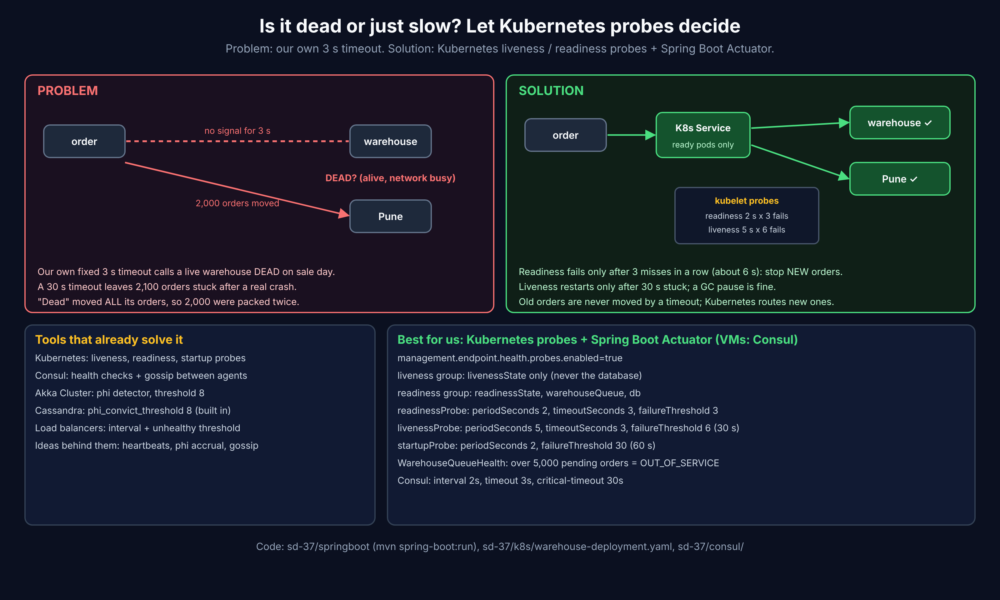

# Video 37 concept diagram

Problem (left): our own 3 s timeout calls a live warehouse dead on sale day and moves 2,000 orders. Solution (right): Kubernetes probes decide; the Service sends new orders only to ready warehouses. Bottom: tools that already solve it, and the configuration we use (Actuator probe groups, readiness 2 s x 3, liveness 5 s x 6, startup 60 s, Consul equivalents).

Code: `sd-37/` (see its README). Source: `architecture.svg`.
