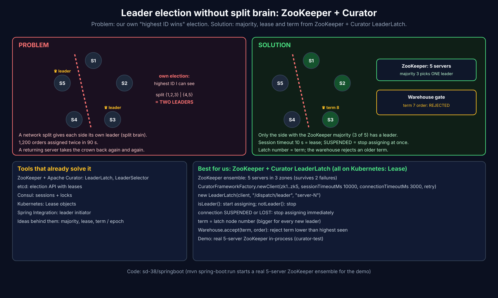

# Video 38 concept diagram

Problem (left): our own highest-ID election gives two leaders in a network split. Solution (right): ZooKeeper's majority picks one leader with a term; the warehouse rejects an older term. Bottom: tools that already solve it, and the Curator LeaderLatch configuration.

Code: `sd-38/` (see its README). Source: `architecture.svg`.
