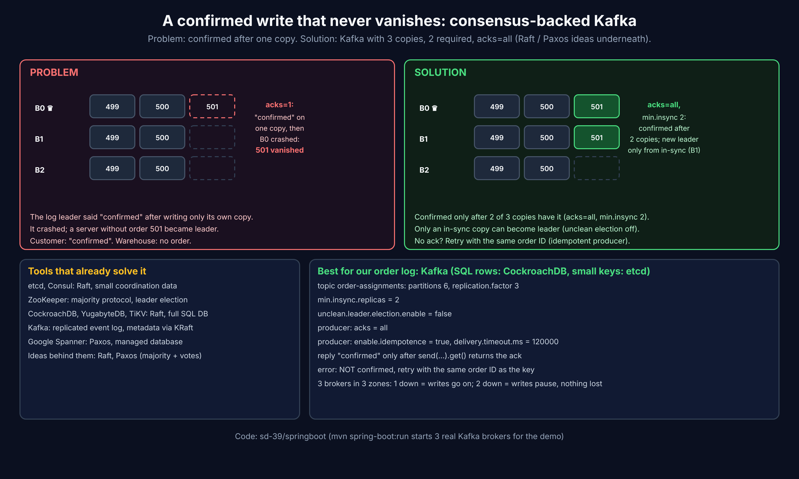

# Video 39 concept diagram

Problem (left): the log leader confirmed order 501 after one copy and crashed. Solution (right): Kafka confirms after 2 of 3 copies and only an in-sync copy can lead. Bottom: tools built on Raft / Paxos ideas, and the Kafka topic and producer settings.

Code: `sd-39/` (see its README). Source: `architecture.svg`.
